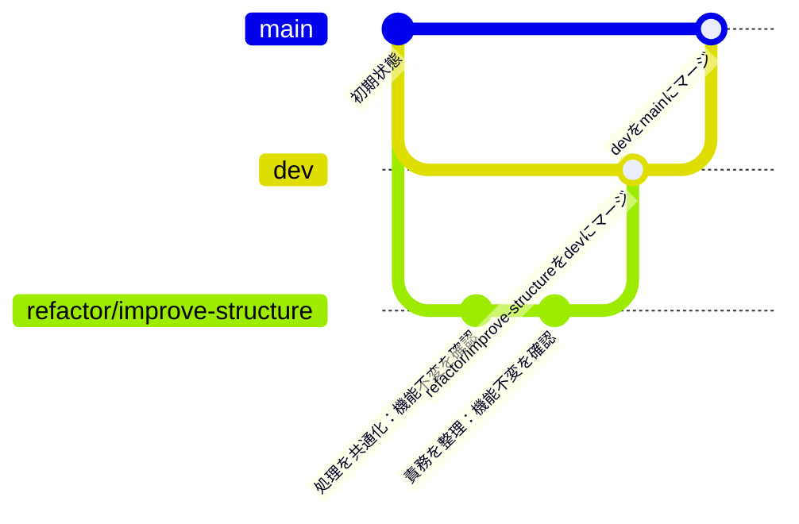

# リファクタリング：refactor

## 運用方針

- `dev`から`refactor/*`の作業ブランチを作成する。
- 変更の都度、アプリケーション本来の機能が変化していないことを確認する。
- 確認が完了した変更をコミットする。
- 作業内容を`dev`にマージし、preview版で動作確認を行う。
- 統合・確認後に作業ブランチを削除する。
- `dev`を`main`にマージしてリリースする。
- `main`と`dev`は継続利用する。

## 運用フロー



図は分岐・マージの関係を示す模式図であり、ブランチ削除操作は表現していない。

## 操作手順

`001-setup.md`の初期設定を実施済みであり、
`main`と`dev`がローカルに存在することを前提とする。

```bash
# mainブランチにいること、未コミットの変更がないことを確認
git status

# devから作業ブランチを作成
git switch dev
git switch -c refactor/improve-structure

# 変更前の動作を確認し、比較基準を整理する

# ここから、変更の都度、以下を繰り返す
# 1. コードを変更する
# 2. アプリケーション本来の機能が変化していないことを確認する
# 3. 意図しない変化がある場合は修正し、再確認する
# 4. 確認完了後、変更をコミットする
git add .
git commit -m "重複する処理を共通化"

# 必要な変更・確認・コミットの完了後、push
git push -u origin refactor/improve-structure

# マージ前のログ確認
git switch dev
git log --graph --oneline --decorate dev..refactor/improve-structure

# 内容を確認後、devへ統合
git merge refactor/improve-structure \
  -m "refactor/improve-structureをdevにマージ：内部構造を整理"
git push -u origin dev

# ここでpreview版の動作確認を行い、
# アプリケーション本来の機能が変化していないことを確認する

# マージ・push・動作確認の完了後、作業ブランチを削除
git branch -d refactor/improve-structure
git push origin --delete refactor/improve-structure

# mainへ統合・リリース
git switch main
git merge dev \
  -m "devをmainにマージ：内部構造の整理をリリース"
git push -u origin main

# 全体ログを確認
git log --graph --oneline --decorate --all

# ここで本番環境への反映・動作確認を行う
```

## 機能が変化していないことの確認

作業開始前に確認対象と方法を整理し、変更の都度、変更前と比較する。

- 既存の入力に対する出力・処理結果
- 画面表示・操作・画面遷移
- データの登録・更新・削除・取得結果
- バリデーション・エラー時の動作
- 変更箇所が影響する周辺機能

プロジェクトに用意されているテストや動作確認手順を使用する。
具体的なテストコマンドは、対象アプリケーションに合わせて定める。

## 運用上の注意

- 上記は段階ごとに確認しながら実行する手順であり、一括実行しない。
- 機能不変の確認は、作業全体の最後だけでなく変更の都度行う。
- 意図しない機能変化が残っている状態では、次の変更や統合に進まない。
- 機能追加や仕様変更は混在させず、別の作業として扱う。
- 競合を解消した場合も、機能が変化していないことを再確認する。
- 競合やエラーが発生した場合は中断し、解消・確認後に次へ進む。
- 作業ブランチの削除には`-d`を使用し、削除できない場合は理由を確認する。
- `main`と`dev`は削除しない。
