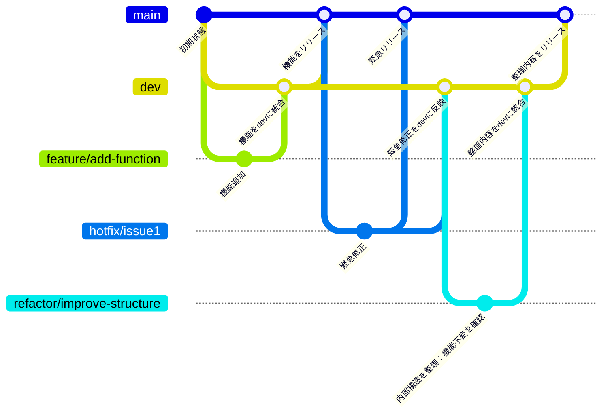

# Git運用ガイド

本リポジトリにおけるブランチ構成、作業フロー、コミット規約のダイジェスト。

## ドキュメント構成

| ファイル                                         | 内容                                       |
|--------------------------------------------------|--------------------------------------------|
| [001-setup.md](001-setup.md)                     | 初期設定・ブランチ構成・コミット規約       |
| [002-basic-operation.md](002-basic-operation.md) | 機能追加からリリースまでの基本操作         |
| [003-hotfix.md](003-hotfix.md)                   | 緊急修正の本番適用・開発環境への反映       |
| [004-refactor.md](004-refactor.md)               | 機能不変を確認しながら行うリファクタリング |

## 初期設定

各開発者がclone後に実行する。

```bash
git config --local merge.ff false
git config --local --get merge.ff
```

以降は、この設定を前提として`git merge`の`--no-ff`を省略する。
設定はローカルリポジトリ単位であり、pushでは共有されない。

## ブランチ構成

| ブランチ     | 用途                                        | 分岐元               | マージ先            |
|--------------|---------------------------------------------|----------------------|---------------------|
| `main`       | リリース用。本番環境。                      | —                    | —                   |
| `dev`        | preview版。開発環境としてのメインブランチ。 | `main`（初回作成時） | `main`              |
| `feature/*`  | 機能追加                                    | `dev`                | `dev`               |
| `hotfix/*`   | 緊急対応                                    | `main`               | `main`、その後`dev` |
| `refactor/*` | リファクタリング                            | `dev`                | `dev`               |

`main`と`dev`は継続利用する。
作業ブランチは、必要なマージ・push・動作確認の完了後に削除する。

## 作業フロー

### 機能追加

1. `dev`から`feature/*`を作成する。
2. 実装・動作確認後、コミット・pushする。
3. マージ対象のログを確認し、`dev`にマージ・pushする。
4. preview版の動作確認後、作業ブランチを削除する。
5. `dev`を`main`にマージ・pushしてリリースする。

### 緊急対応

1. `main`から`hotfix/*`を作成する。
2. 修正・動作確認後、コミット・pushする。
3. マージ対象のログを確認し、`main`にマージ・pushして緊急リリースする。
4. 本番環境への反映・動作確認後、同じhotfixブランチを`dev`にもマージ・pushする。
5. preview版の動作確認後、作業ブランチを削除する。

`dev`には`main`全体ではなく、作成したhotfixブランチを直接マージする。

### リファクタリング

基本の流れは機能追加と同じとし、`refactor/*`を使用する。

変更の都度、アプリケーション本来の機能が変化していないことを確認してからコミットする。
意図しない変化がある場合は、修正・再確認が完了するまで次へ進まない。

機能追加や仕様変更は混在させず、別の作業として扱う。

### 分岐・マージの全体像



各作業パターンを順番に並べた模式図であり、
実際の作業順序を固定するものではない。
ブランチ削除操作は図には表示していない。

## コミット規約

| 種類           | メッセージの方針                                       |
|----------------|--------------------------------------------------------|
| 通常のコミット | ブランチ名を含めず、変更内容を簡潔な日本語で記載する。 |
| マージコミット | マージ元・マージ先のブランチ名と統合内容を記載する。   |

```bash
git commit -m "検索機能を追加"

git merge feature/add-function \
  -m "feature/add-functionをdevにマージ：検索機能を追加"

git merge dev \
  -m "devをmainにマージ：検索機能をリリース"
```

## ログ確認

### マージ前

マージ先に未統合のコミットを確認する。

```bash
# feature → dev
git log --graph --oneline --decorate dev..feature/add-function

# hotfix → main
git log --graph --oneline --decorate main..hotfix/issue1

# hotfix → dev
git log --graph --oneline --decorate dev..hotfix/issue1

# refactor → dev
git log --graph --oneline --decorate dev..refactor/improve-structure
```

### mainへのマージ・push完了後

GitLabのリポジトリグラフに似た形式で、全体の履歴を確認する。

```bash
git log --graph --oneline --decorate --all
```

## 作業ブランチの削除

必要なマージ・push・動作確認の完了後、
ローカルとリモートの両方を削除する。

```bash
git branch -d feature/add-function
git push origin --delete feature/add-function
```

- hotfixは、`main`と`dev`の両方への適用完了後に削除する。
- 通常手順では強制削除の`-D`を使用しない。
- `main`と`dev`は削除しない。
- 統合済みコミットとマージの構造は、作業ブランチ削除後も残る。
- 削除したブランチ名は、マージコミットのメッセージで確認する。
- ブランチ作成操作そのものや作成日時を記録するものではない。

## 作業用スクリプト

実行環境はmacOS・zshとする。

```text
gemini-scripts/{NNN}-{name}.sh
```

スクリプトの先頭は以下とする。

```zsh
#!/bin/zsh
set -euo pipefail
```

末尾には、作業内容に応じた簡潔な日本語メッセージでコミットする処理を記載する。

```bash
git add .
git commit -m '簡潔な日本語メッセージ'
```

`git add .`に無関係な変更や機密ファイルが含まれないことを、
実行前に確認する。

## patchディレクトリの追跡除外

ローカルの`patch/`を残したまま追跡対象から外す場合は、
リポジトリのルートで実行する。
`.gitignore`に`/patch/`が未登録の場合に追加する。

```bash
git rm -r --cached patch/
printf '\n/patch/\n' >> .gitignore

git add .
git commit -m 'パッチ用ディレクトリを追跡対象から除外'
```

この操作は、過去のコミット内にあるファイルの履歴を削除するものではない。

## 共通の注意事項

- 操作手順は段階ごとに確認しながら実行し、一括実行しない。
- 作業開始前に、現在のブランチと未コミットの変更を確認する。
- 競合やエラーが発生した場合は中断し、解消・確認後に次へ進む。
- 競合解消後も、必要な動作確認を行う。
- 本番環境・preview版への反映と動作確認を、各手順に沿って行う。
