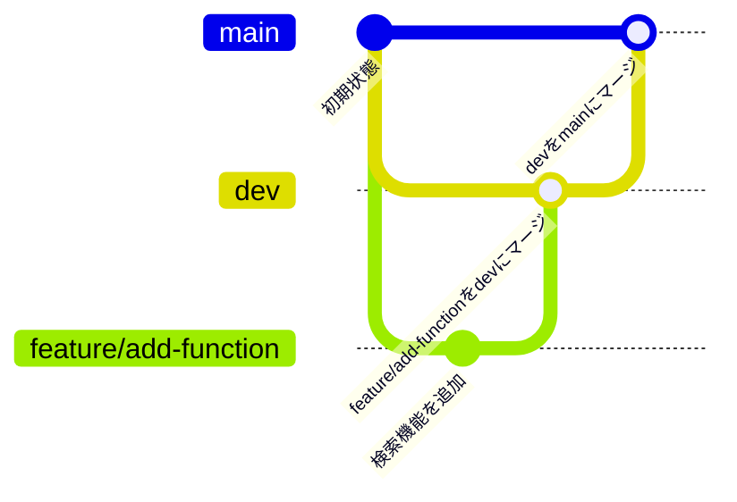

# Git運用方針

## 1. 初期設定

対象リポジトリ内で、以下を実行する。

```bash
# マージ時に--no-ff相当の動作をデフォルトにする
git config --local merge.ff false

# falseと表示されることを確認
git config --local --get merge.ff
```

- fast-forward可能な場合も、マージコミットを作成する。
- すでに統合済みで変更がない場合は、新たなマージコミットは作成されない。
- 以降の手順では、この設定を前提として`git merge`の`--no-ff`を省略する。
- 設定はローカルリポジトリ単位であり、pushでは共有されない。
- 各開発者がclone後に実行する。

## 2. ブランチ構成

| ブランチ | 用途・位置付け | 扱い |
| --- | --- | --- |
| `main` | リリース用。本番環境。 | 継続利用する。 |
| `dev` | preview版。開発環境としてのメインブランチ。 | 継続利用する。 |
| `feature/*` | 機能追加の作業ブランチ。 | `dev`から分岐し、`dev`への統合後に削除する。 |
| `hotfix/*` | 緊急対応の作業ブランチ。 | 分岐元・マージ先・削除タイミングは未定。 |
| `refactor/*` | リファクタリング用の作業ブランチ。 | 分岐元・マージ先・削除タイミングは未定。 |

## 3. コミットメッセージ

### 3.1. 通常のコミット

作業ブランチ名は含めず、変更内容を簡潔な日本語で記載する。

```bash
git commit -m "検索機能を追加"
```

### 3.2. マージコミット

マージ元とマージ先のブランチ名を明記し、統合内容を簡潔な日本語で記載する。

```bash
git merge feature/add-function \
  -m "feature/add-functionをdevにマージ：検索機能を追加"

git merge dev \
  -m "devをmainにマージ：検索機能をリリース"
```

## 4. 機能追加からリリースまでの流れ



この図は、分岐・マージの関係を示す模式図である。
作業ブランチの削除操作は図には表示せず、以下の手順に記載する。

### 4.1. 作業開始前の確認

```bash
# mainブランチにいることと、未コミットの変更がないことを確認
git status
```

### 4.2. devブランチの準備

`dev`を初めて作成する場合：

```bash
git switch -c dev
```

`dev`がすでに存在する場合：

```bash
git switch dev
```

上記のいずれか一方を実行する。

### 4.3. featureブランチの作成

```bash
git switch -c feature/add-function
```

### 4.4. 機能の実装・コミット・push

コードを変更し、動作確認を行った後、以下を実行する。

```bash
git add .
git commit -m "検索機能を追加"
git push -u origin feature/add-function
```

### 4.5. マージ対象のログ確認

`dev`に切り替え、今回統合するコミットを確認する。

```bash
git switch dev

# feature側にあり、devには取り込まれていないコミットのみを表示
git log --graph --oneline --decorate dev..feature/add-function
```

`dev..feature/add-function`は、`feature/add-function`から到達できる
コミットのうち、`dev`から到達できるコミットを除外する指定である。

分岐前の共通履歴を除き、マージ対象を確認するために使用する。

### 4.6. devへのマージ

```bash
git merge feature/add-function \
  -m "feature/add-functionをdevにマージ：検索機能を追加"

git push -u origin dev
```

マージ後は、devのpreview版で動作確認を行う。

競合が発生した場合やコマンドが失敗した場合は、そこで手順を中断し、
解消・確認が完了してから次の操作へ進む。

### 4.7. 作業ブランチの削除

devへのマージ・pushの成功と動作確認の完了後、
ローカルとリモートの作業ブランチを削除する。

```bash
# ローカルの作業ブランチを削除
git branch -d feature/add-function

# リモートの作業ブランチを削除
git push origin --delete feature/add-function
```

- `main`と`dev`は削除しない。
- ローカルの削除には`-d`を使用する。
- 削除できない場合は理由を確認し、通常手順では強制削除の`-D`を使わない。

### 4.8. mainへのマージ・リリース

```bash
git switch main

git merge dev \
  -m "devをmainにマージ：検索機能をリリース"

git push -u origin main
```

### 4.9. 全体ログの確認

mainへのマージとpushが完了した後、全体の履歴を確認する。

```bash
git log --graph --oneline --decorate --all
```

GitLabのリポジトリグラフに似た分岐・マージの構造を、
ターミナル上でテキスト表示する。

| オプション | 内容 |
| --- | --- |
| `--graph` | コミット間のつながりを線で表示する。 |
| `--oneline` | 短縮ハッシュとコミットメッセージを1行で表示する。 |
| `--decorate` | ブランチ名・タグ名などを表示する。 |
| `--all` | ローカルにある全参照とHEADを起点に履歴を表示する。 |

`--all`は、リモートサーバーの最新情報を自動取得する指定ではない。

## 5. ブランチ削除後の履歴

- マージ先から到達できる作業コミットは、作業ブランチを削除しても残る。
- `merge.ff false`により、分岐・統合の構造をマージコミットとして残す。
- 削除したブランチ名のラベルは表示されなくなる。
- マージコミットのメッセージにブランチ名を記載し、統合元を確認できるようにする。
- ブランチ作成操作そのものや、その実行日時を記録するものではない。

## 6. 作業用スクリプトの方針

### 6.1. 実行環境

- macOS
- zsh

### 6.2. 配置・命名規則

```text
gemini-scripts/{NNN}-{name}.sh
```

例：

```text
gemini-scripts/001-create-git-workflow.sh
```

スクリプトの先頭には、以下を記載する。

```zsh
#!/bin/zsh
set -euo pipefail
```

### 6.3. スクリプト末尾のコミット

作業用スクリプトの末尾には、以下を記載する。
コミットメッセージは、実際の作業内容に合わせた簡潔な日本語とする。

```bash
git add .
git commit -m '簡潔な日本語メッセージ'
```

`git add .`は実行位置以下の変更をまとめてステージングするため、
実行前に無関係な変更や機密ファイルが含まれていないことを確認する。

## 7. 今後決定する事項

- hotfixブランチの分岐元・マージ先・削除タイミング
- refactorブランチの分岐元・マージ先・削除タイミング
